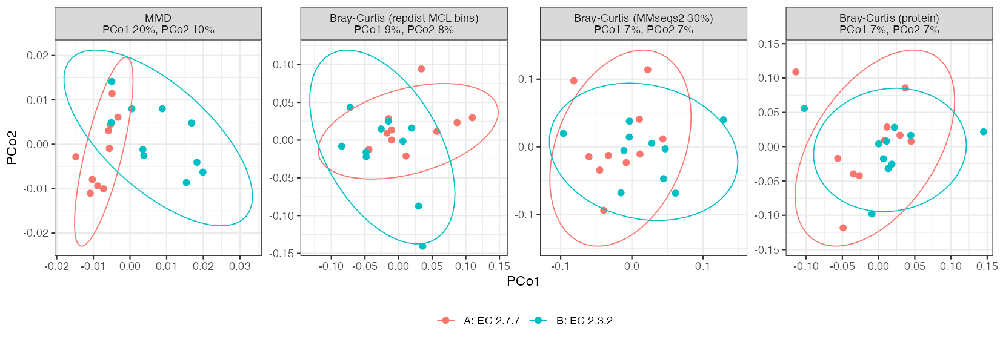

# repdist

**Measure, analyze and compare protein representation distances**

`repdist` represents each sample as an abundance-weighted distribution over
protein embeddings and compares samples with maximum mean discrepancy
(MMD), giving a beta-diversity metric that is aware of protein representation
similarity rather than exact sequence identity alone. The same embeddings also
cluster proteins into structural bins by Markov clustering (MCL).

The default `TM-Vec` model predicts structural similarity: cosine similarity
between protein embeddings approximates the TM-score. The corresponding cosine
distance is `1 - similarity`.



Two groups of ten simulated samples over 1,160 Swiss-Prot enzymes, enriched
for different enzyme classes (EC 2.7.7 and EC 2.3.2) with 5% of their
abundance. Every enriched enzyme comes from a different 50%-identity MMseqs2
cluster, so no enriched protein or sequence family is shared. Every distance
uses relative abundances. Ellipses are 95% ellipses per group. PERMANOVA and
PERMDISP, 999 permutations:

| Distance | PERMANOVA R² | PERMANOVA p | PERMDISP p |
| --- | --- | --- | --- |
| MMD | 0.133 | 0.001 | 0.468 |
| Bray-Curtis (repdist MCL bins) | 0.063 | 0.020 | 0.186 |
| Bray-Curtis (MMseqs2 30%) | 0.052 | 0.580 | 0.461 |
| Bray-Curtis (protein) | 0.050 | 0.787 | 0.458 |

This is the [vignette](https://yixuan39.github.io/repdist/vignette.html)'s
dataset, `data(simulate_ec)`; the
[simulation page](https://yixuan39.github.io/repdist/simulation.html)
repeats the design over 28 pairs of enzyme classes.

## What you need

| Input | Form |
| --- | --- |
| Protein sequences | FASTA file, or a named character vector; the names are protein IDs |
| Protein counts | matrix with samples in rows and proteins in columns, column names matching the protein IDs (e.g. PSM or spectral counts) |
| Sample metadata | data frame with one row per sample, row names matching the count rows |

Python, conda and git do not need to be installed: the first
`embed_proteins()` call downloads a standalone Python and sets up a private,
version-pinned environment (up to a few GB, once), on Windows, macOS and
Linux. Embeddings from the
`tmvec` command-line tool can be read with `read_embeddings()` instead.

**New to repdist? Start with the
[vignette](https://yixuan39.github.io/repdist/vignette.html)**, a worked
example on simulated data with a known answer: beta diversity, MCL
protein bins and differential abundance.

## Simulated example data

```r
data(simulate_ec, package = "repdist")
dim(simulate_ec$counts) # 20 samples by 1160 enzymes
```

`simulate_ec` holds the enzyme sequences with precomputed TM-Vec embeddings,
simulated counts, sample groups, EC annotations with the enriched proteins,
and source provenance. Loading it needs no model download. The [simulated
data page](https://yixuan39.github.io/repdist/simulation_data.html) explains
how it was built.

## Install

After acceptance into Bioconductor:

```r
if (!requireNamespace("BiocManager", quietly = TRUE))
    install.packages("BiocManager")
BiocManager::install("repdist", dependencies = TRUE)
```

Until then, install the development version with Bioconductor dependencies:

```r
if (!requireNamespace("BiocManager", quietly = TRUE))
    install.packages("BiocManager")
BiocManager::install(c("basilisk", "BiocFileCache", "BiocParallel",
    "Biostrings", "pwalign", "rhdf5", "S4Vectors", "MCL"))
if (!requireNamespace("remotes", quietly = TRUE))
    install.packages("remotes")
# dependencies = TRUE also installs vegan, ggplot2, Rtsne and DESeq2 for the vignette
remotes::install_github("Yixuan39/repdist", dependencies = TRUE)
```

## Quick start

```r
library(repdist)

proteins <- embed_proteins("proteins.fasta", model = "tmvec")
# or, from the tmvec command-line tool:
# proteins <- read_embeddings("db/proteins.npz", seqs = "proteins.fasta")

# Beta diversity between samples
D <- sample_mmd(counts, proteins)
vegan::adonis2(D ~ condition, data = meta)

# Structure-level protein clusters, e.g. for biomarker discovery
S <- protein_similarity(proteins, min_sim = 0.7, min_coverage = 0.5)
bins <- bin_proteins(S, inflation = 2)
bin_counts <- bin_glom(counts, bins) # samples x bins
```

`proteins` is an `AAStringSet` of the sequences with the embeddings in
`mcols(proteins)$embedding`. `protein_similarity()` sets pairs below `min_sim`
to 0, and pairs whose alignment covers less than `min_coverage` of either
sequence. `bin_proteins()` runs MCL on the remaining edges. The floor applies
to edges, not all pairs: a bin can hold pairs below it. Structural similarity
alone does not guarantee shared function, so weigh annotation agreement
against how much of the catalog the non-singleton bins hold, and how far
families fragment, before transferring labels.

## License

Package code: MIT. Example data: CC BY 4.0; see
[the data provenance and attribution](inst/scripts/DATA_PROVENANCE.md).
