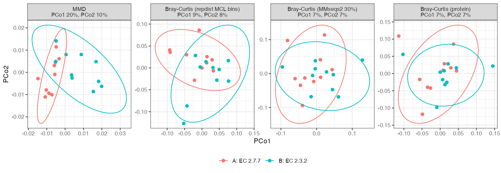

# repdist

[](https://github.com/Yixuan39/repdist/actions/workflows/R-CMD-check.yaml)
[](https://codecov.io/gh/Yixuan39/repdist)

**Measure, analyze and compare protein representation distances**

`repdist` represents each sample as an abundance-weighted distribution over
protein embeddings and compares samples with maximum mean discrepancy
(MMD), giving a beta-diversity metric that is aware of protein representation
similarity rather than exact sequence identity alone. The same embeddings also
cluster proteins into structural bins by Markov clustering (MCL).

The default `TM-Vec` model predicts structural similarity: cosine similarity
between protein embeddings approximates the TM-score. The corresponding cosine
distance is `1 - similarity`.



Two groups of ten simulated samples over 1,160 Swiss-Prot enzymes, enriched
for different enzyme classes (EC 2.7.7 and EC 2.3.2) with 5% of their
abundance. Every enriched enzyme comes from a different 50%-identity MMseqs2
cluster, so no enriched protein or sequence family is shared. Every distance
uses relative abundances. Ellipses are 95% ellipses per group. PERMANOVA and
PERMDISP, 999 permutations:

| Distance | PERMANOVA R² | PERMANOVA p | PERMDISP p |
| --- | --- | --- | --- |
| MMD | 0.133 | 0.001 | 0.468 |
| Bray-Curtis (repdist MCL bins) | 0.065 | 0.010 | 0.288 |
| Bray-Curtis (MMseqs2 30%) | 0.052 | 0.580 | 0.461 |
| Bray-Curtis (protein) | 0.050 | 0.787 | 0.458 |

This is the [vignette](https://yixuan39.github.io/repdist/vignette.html)'s
dataset, `data(simulate_ec)`; the
[simulation page](https://yixuan39.github.io/repdist/simulation.html)
repeats the design over 28 pairs of enzyme classes.

## What you need

| Input | Typical file | Read with |
| --- | --- | --- |
| Protein sequences | FASTA, one record per protein, the protein ID first in the header | `embed_proteins()`, or `read_embeddings()` for `tmvec` output |
| Protein counts | tab-separated, samples in rows, sample IDs in the first column, protein IDs as column names (e.g. PSM or spectral counts) | `as.matrix(read.delim(f, row.names = 1, check.names = FALSE))` |
| Sample metadata | tab-separated, one row per sample, in the count table's row order | `read.delim()` |

`inst/extdata` ships one of each, 100 proteins of a mouse gut metaproteome in
23 samples on two diets, plus their `tmvec` embeddings; the
[Quick start](#quick-start) runs from them.

Python, conda and git do not need to be installed: the first
`embed_proteins()` call downloads a standalone Python and sets up a private,
version-pinned environment (up to a few GB, once), on Windows, macOS and
Linux. Embeddings from the
`tmvec` command-line tool can be read with `read_embeddings()` instead.

**New to repdist? Start with the
[vignette](https://yixuan39.github.io/repdist/vignette.html)**
(`vignette("repdist")`), a worked beta-diversity example on simulated data
with a known answer. Protein clustering and differential abundance
(`protein_similarity()`, `bin_proteins()`, `bin_glom()`) have their own
`vignette("clustering")`.

## Simulated example data

```r
data(simulate_ec, package = "repdist")
dim(simulate_ec$counts) # 20 samples by 1160 enzymes
```

`simulate_ec` holds the enzyme sequences with precomputed TM-Vec embeddings,
simulated counts, sample groups, EC annotations with the enriched proteins,
and source provenance. Loading it needs no model download.
[DATA_PROVENANCE.md](inst/scripts/DATA_PROVENANCE.md) explains how it was
built.

## Install

After acceptance into Bioconductor:

```r
if (!requireNamespace("BiocManager", quietly = TRUE))
    install.packages("BiocManager")
BiocManager::install("repdist", dependencies = TRUE)
```

Until then, install the development version with Bioconductor dependencies.
You need R >= 4.5; Rtools is not needed on Windows. On Linux, R compiles some
dependencies from source and needs these system libraries first:

```sh
# Debian/Ubuntu
sudo apt-get install -y curl build-essential gfortran cmake libcurl4-openssl-dev libssl-dev libpng-dev libuv1-dev libbz2-dev libicu-dev
# Fedora/RHEL
sudo dnf install -y curl gcc-c++ gcc-gfortran cmake libcurl-devel openssl-devel libpng-devel libuv-devel bzip2-devel libicu-devel
```

Then, in R:

```r
if (!requireNamespace("BiocManager", quietly = TRUE))
    install.packages("BiocManager")
BiocManager::install(c("basilisk", "BiocFileCache", "BiocParallel",
    "Biostrings", "pwalign", "rhdf5", "S4Vectors", "MCL"))
if (!requireNamespace("remotes", quietly = TRUE))
    install.packages("remotes")
# dependencies = TRUE also installs vegan, ggplot2, Rtsne, limma and DEqMS for the vignette
remotes::install_github("Yixuan39/repdist", dependencies = TRUE)
```

## Quick start

This runs as shown, on the bundled `simulate_ec` data, with no model
download and no file of your own:

```r
library(repdist)

data(simulate_ec, package = "repdist")
proteins <- simulate_ec$proteins # AAStringSet, embeddings in mcols()$embedding
counts <- simulate_ec$counts     # 20 samples x 1160 proteins
meta <- simulate_ec$samples      # one row per sample; `group` is "A" or "B"

# Beta diversity between samples
D <- sample_mmd(counts, proteins)
vegan::adonis2(D ~ group, data = meta)

# Structure-level protein clusters, e.g. for biomarker discovery (a 100-protein
# subset here, for speed: protein_similarity() aligns every pair)
keep <- names(proteins)[1:100]
S <- protein_similarity(proteins[keep], max_evalue = 0.01)
bins <- bin_proteins(S, inflation = 2)
bin_counts <- bin_glom(counts[, keep], bins) # samples x bins
```

`proteins` is an `AAStringSet` of the sequences with the embeddings in
`mcols(proteins)$embedding`; `simulate_ec` ships with its embeddings already
computed, so loading it needs no model download. `protein_similarity()`
aligns every pair and keeps the predicted TM-score of those whose alignment
E-value is at most `max_evalue`, so its time grows with the square of the
number of proteins. `bin_proteins()` runs MCL on the remaining edges. The
gate applies to edges, not all pairs: a bin can hold pairs that did not pass
it. Structural similarity alone does not guarantee shared function, so weigh
annotation agreement against how much of the catalog the non-singleton bins
hold, and how far families fragment, before transferring labels.

The same from files, with the examples in `inst/extdata` (also runs as
shown); swap in your own paths:

```r
ex <- function(f) system.file("extdata", f, package = "repdist")
proteins <- read_embeddings(ex("metaproteomics.npz"), ex("metaproteomics.fasta"))
# or compute the embeddings (downloads the model on first use):
# proteins <- embed_proteins(ex("metaproteomics.fasta"))
counts <- as.matrix(read.delim(ex("metaproteomics_counts.tsv"),
    row.names = 1, check.names = FALSE))
meta <- read.delim(ex("metaproteomics_samples.tsv"))
D <- sample_mmd(counts, proteins)
vegan::adonis2(D ~ diet, data = meta)
```

## License

Package code: MIT. Example data: CC BY 4.0; see
[the data provenance and attribution](inst/scripts/DATA_PROVENANCE.md).
